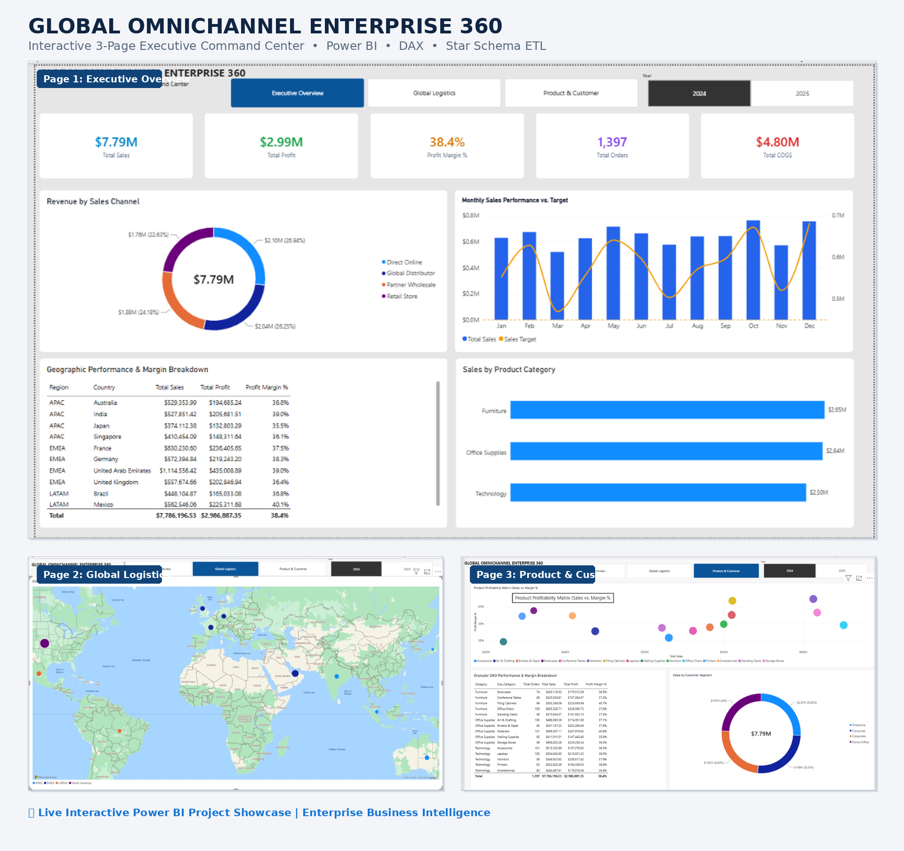

# Global Omnichannel Enterprise 360 Analytics Dashboard

## Executive Overview
An enterprise-grade Power BI business intelligence reporting suite built to monitor multi-channel revenue streams ($7.8M+), supply chain logistics, customer segmentation, and financial pacing benchmarks.

---

## Dashboard Visual


---

## Key Business Metrics & KPIs
* **Total Revenue:** $7.8M+ analyzed across B2B, Marketplace, Online, and Retail store channels
* **Profit Margin Pacing:** Real-time variance tracking against budget targets
* **Supply Chain Fulfillment:** On-Time In-Full (OTIF) delivery metrics and supplier lead time tracking
* **Customer Segmentation:** Channel-by-channel purchase frequency and average order value (AOV)

---

## Technical Architecture & Modeling
* **Data Modeling:** Star Schema architecture connecting normalized dimension tables (`DimDate`, `DimCustomer`, `DimProduct`, `DimChannel`) to core transaction fact tables.
* **ETL Pipeline:** Configured in Power Query (M-Code) for automated null handling, data typing, currency normalization, and clean table staging.
* **DAX Formulas:** 25+ dynamic measures leveraging time intelligence, growth rates, and dynamic conditional formatting.

---

## Core DAX Measures Used

### 1. Year-to-Date Revenue Pacing
```dax
YTD_Revenue = 
CALCULATE(
    [Total Revenue],
    DATESYTD(DimDate[Date])
)
